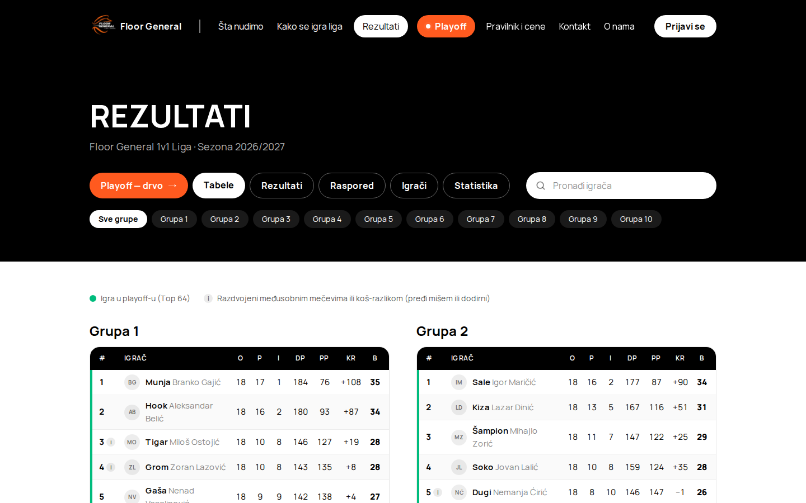
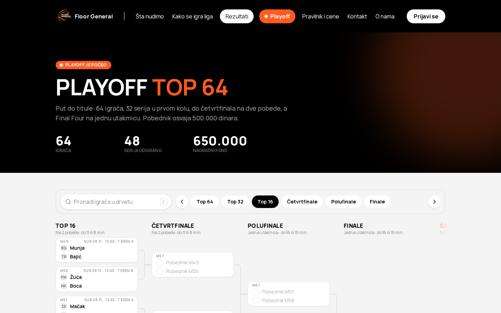
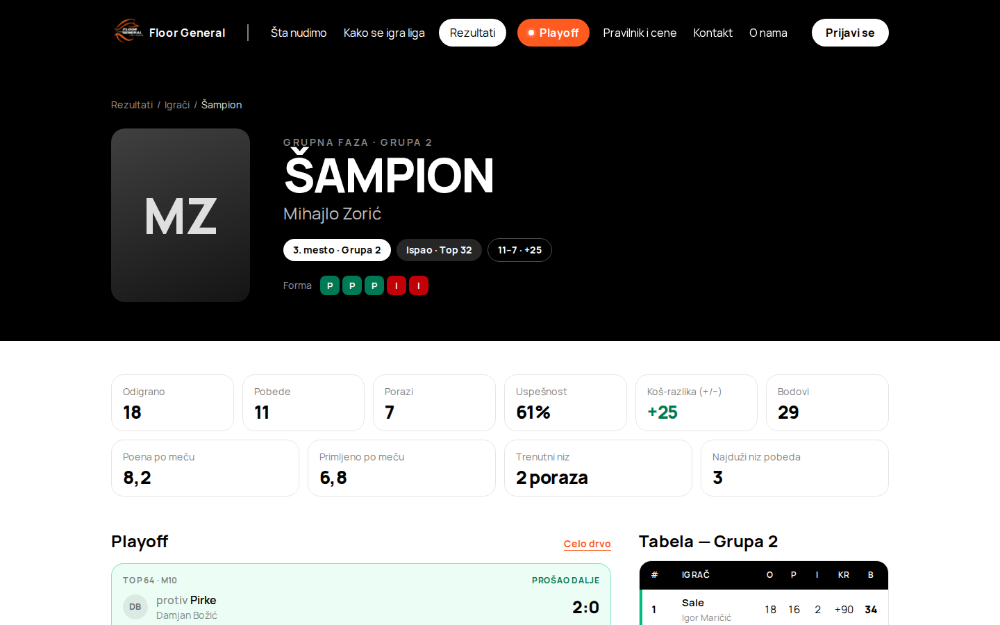
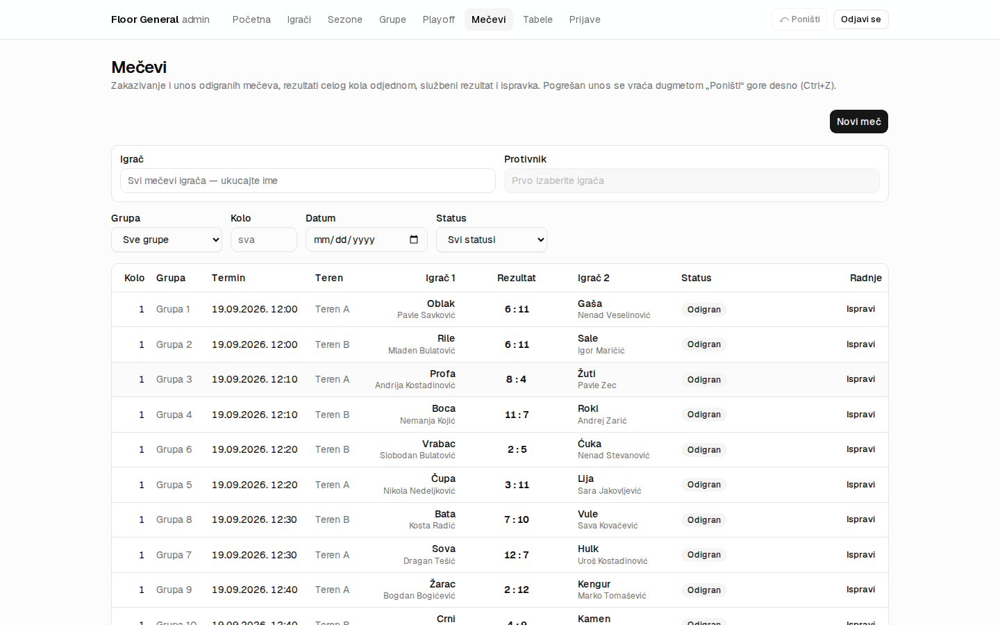
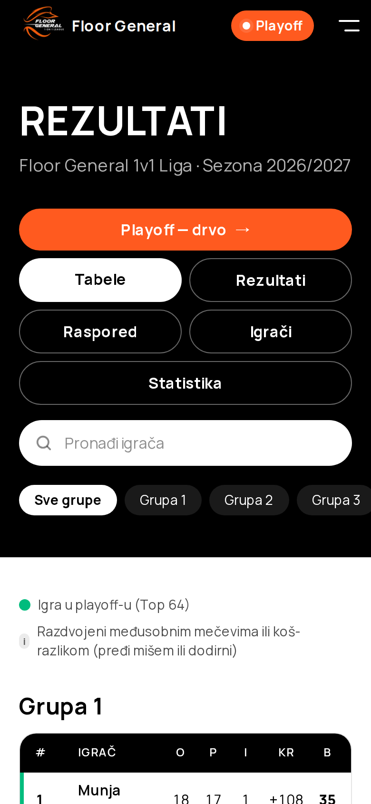

# Floor General — 1v1 basketball league platform

A production web platform for the **Floor General 1-on-1 basketball league** in Belgrade: a public
site with standings, results, player profiles and a live playoff bracket, plus an admin panel that
runs the whole season. 100 players, 10 groups, a double round-robin (900 group-stage matches) and a
64-player playoff with best-of-three series and a Final Four.

Live: **[www.floorgeneral.rs](https://www.floorgeneral.rs)**

> **About this repository.** This is a public snapshot of the private production repository,
> published with the client's permission. Real player data, internal documents and deployment
> identifiers were removed. The development database is seeded with a **fictional league**
> generated by [`Aplikacija/backend/scripts/generisi_demo_seed.py`](Aplikacija/backend/scripts/generisi_demo_seed.py),
> and all the screenshots below show that fictional data.

| Public site | Group standings |
|---|---|
|  |  |
| **Playoff bracket** | **Player profile** |
|  |  |
| **Admin: match and result entry** | **Mobile** |
|  |  |

## What it does

**Public site** (server-rendered for SEO)
- Group standings with explanations of how each tie was broken, plus results, schedule and statistics.
- Player profiles with form, every match, head-to-head records and personal records, all with `schema.org` markup.
- A playoff bracket viewer with series, a Final Four and a third-place game.
- Player search that ignores diacritics and tolerates one typo (`milos risic` finds *Miloš Ristić*).
- A four-step sign-up form for the next season. Applications land in the database and notify the league by e-mail.
- `sitemap.xml`, `robots.txt` and Open Graph previews.

**Admin panel**
- Seasons, stages, groups, players and courts.
- Bulk result entry for a whole round on one screen, because one person enters about 60 matches per evening from paper score sheets.
- Retroactive entry: the league started before the software existed.
- Official results (walkover, forfeit, double forfeit) and corrections.
- Playoff series management that advances winners automatically.
- An applications inbox and an Excel export.
- **Server-side undo** (`Ctrl+Z`) for every admin change. It survives a page refresh and a logout, and undoing a bulk entry restores the whole round.

**Competition engine** (`engine/` package: pure functions with no Spring, JPA or HTTP)
- Standings calculator and the full tie-break chain: head-to-head first. For three or more tied
  players, a mini-table of their mutual games is recomputed from scratch after every separation.
  After that come point difference and points scored in the group.
- Bracket math, series rules and match result validation.
- **No format number is hard-coded.** Points per result, target and maximum score, match length,
  number of groups, how many players advance and bracket size are all data on `Season` and
  `Stage`. A 200-player season with two group stages runs without code changes.

## Tech stack

| Layer | |
|---|---|
| Backend | Java 21, Spring Boot 3.5 (Web, Data JPA, Security, OAuth2 Resource Server, Validation, Mail), Flyway, MapStruct, springdoc-openapi |
| Auth | Stateless JWT (RS256, key generated at startup). The browser never sees the token: it lives in an httpOnly cookie and Next.js proxies API calls |
| Frontend | Next.js 15 (App Router, SSR), React 19, TypeScript, Tailwind CSS 4, shadcn/ui (Radix), TanStack Query, TS types generated from the OpenAPI spec |
| Database | PostgreSQL 16 |
| Tests | JUnit 5, Mockito, Spring Boot Test with **Testcontainers** (real PostgreSQL), Node test runner for frontend logic |
| Infrastructure | AWS (EC2 Graviton/ARM64, EBS, S3, SSM Parameter Store and Session Manager, DLM snapshots), Terraform, Docker Compose, nginx (TLS, caching, rate limiting) |
| CI/CD | GitHub Actions builds `linux/arm64` images and deploys through **OIDC → IAM role → SSM RunCommand**, with no long-lived AWS keys anywhere |

```
browser ──HTTPS──▶ nginx ──▶ Next.js (SSR pages, /api/backend proxy) ──▶ Spring Boot REST ──▶ PostgreSQL
                    │                     httpOnly JWT cookie → Bearer header
                    └─ static caching, rate limiting, Let's Encrypt
```

## Repository layout

```
Aplikacija/backend      Spring Boot API: domain, repository, service, web, security, engine
Aplikacija/frontend     Next.js app: public site (app/(public)) and admin panel (app/admin)
Infrastruktura          Terraform for AWS, docker-compose and nginx for the server, backup scripts,
                        and the production deploy workflow kept for reference (deploy/github-deploy.yml)
.github/workflows/ci.yml   build and tests on every push and pull request
```

## Running locally

Requires Docker, Java 21 with Maven, and Node.js 24.

```bash
# 1. database (PostgreSQL 16 on localhost:55432)
cd Aplikacija/backend
docker compose up -d

# 2. backend on http://localhost:8080 (Swagger UI: /swagger-ui.html)
#    The default "dev" profile migrates the schema and loads the fictional league.
mvn spring-boot:run

# 3. frontend on http://localhost:3000
cd ../frontend
cp .env.example .env.local
npm ci
npm run dev
```

The admin panel is at `/admin`. Use the local-only account `admin` / `admin123`, which `AdminSeeder`
creates on first start. Production has no default password.

```bash
cd Aplikacija/backend && mvn verify                                  # unit + integration tests (needs Docker)
cd Aplikacija/frontend && npm run lint && npx tsc --noEmit && npm test
```

## Notes

- Identifiers are in English. Comments, domain documentation and UI text are in Serbian, the client's language.
- Comments refer to business rules by ID (`BR-03`, `FR-6.1.13`) and to project decisions by ID (`D-18`, `D-22`).
  These come from the client's specification and the project's decision log, which are not part of this snapshot.
- The source code is shared for review and portfolio purposes. All rights reserved; no license is granted.
